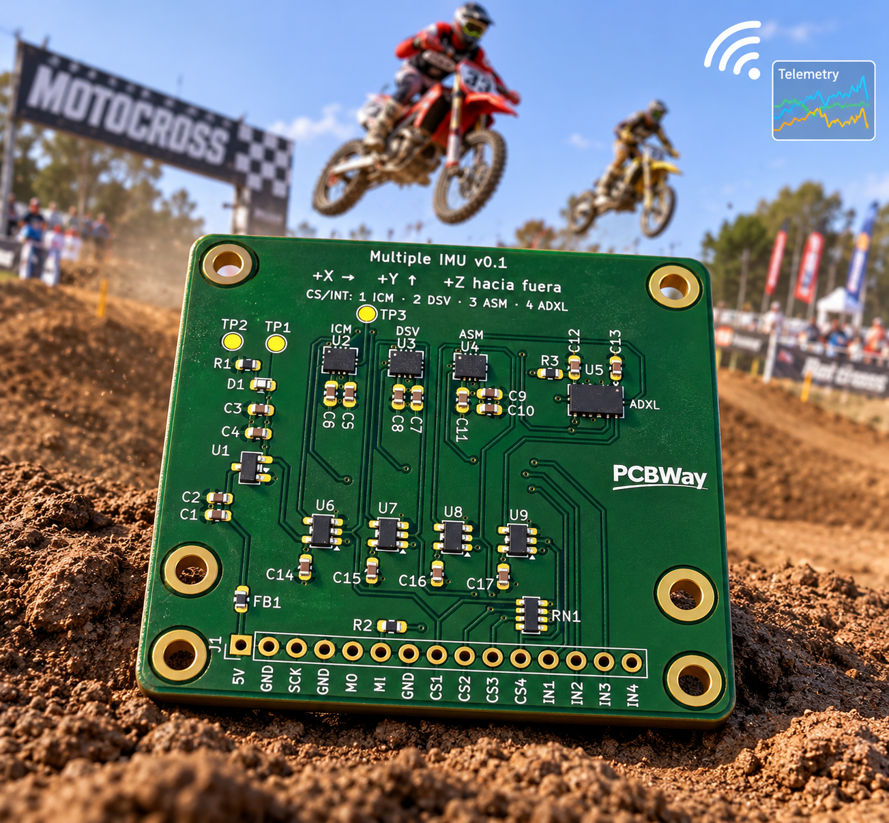
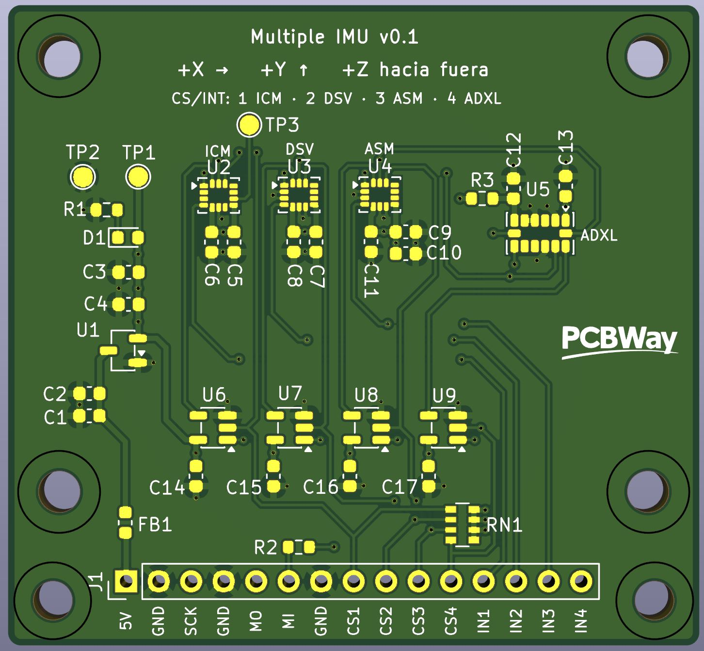
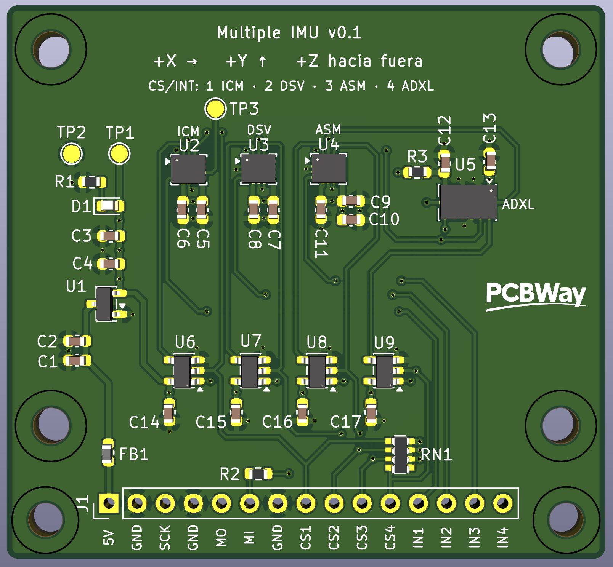
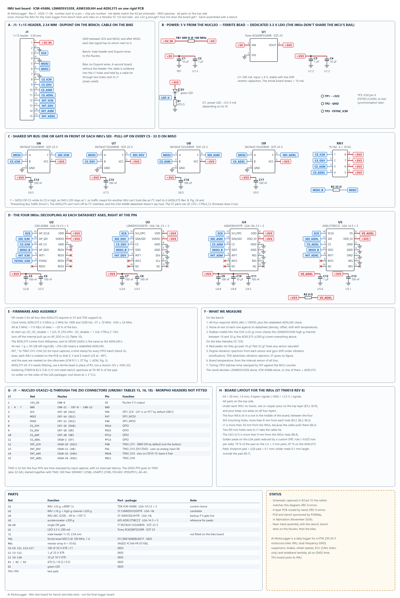

# IMU Test Board

Four inertial sensors on one small, rigid PCB: **TDK ICM-45686**, **ST LSM6DSV320X**, **ST ASM330LHH** and
**ADI ADXL375**. Because they sit side by side on the same board, all four feel the same shocks, vibration and
temperature on a motocross bike, so their data can be compared directly.

The board is a test fixture for AI MotoLogger, a data logger for a motocross bike. The test results decide which IMU
goes on the main logger board.



*Concept illustration. The renders below show the actual board.*

| Bare board | Assembled board (3D render) |
|:---:|:---:|
|  |  |

## Sensors

| Ref | Part | Type | Accelerometer | Gyroscope | Package |
|---|---|---|---|---|---|
| U2 | TDK InvenSense ICM-45686 | 6-axis IMU | ±32 g | ±4000 dps | LGA-14, 2.5 × 3 mm |
| U3 | ST LSM6DSV320X | 6-axis IMU with a high-g channel | ±16 g, plus a ±320 g channel | ±4000 dps | LGA-14L, 2.5 × 3 mm |
| U4 | ST ASM330LHH | 6-axis IMU, automotive (AEC-Q100, −40 to +105 °C) | ±16 g | ±4000 dps | LGA-14L, 2.5 × 3 mm |
| U5 | ADI ADXL375 | 3-axis accelerometer | ±200 g | — | LGA-14, 3 × 5 mm |

The silkscreen numbers the chip selects and interrupts as `1 ICM · 2 DSV · 3 ASM · 4 ADXL`. The sensors are rotated
on the PCB so that their X, Y and Z axes match (U5 sits at −90° for this reason). The silkscreen marks the axes:
+X to the right, +Y up, and +Z out of the board (the silkscreen says *"+Z hacia fuera"*).

## What it is for

Each test answers one question.

On the bench:

1. Do all four sensors respond? Read `WHO_AM_I` / `DEVID`, and check that the ADXL375 is genuine (see the firmware notes).
2. How noisy is each sensor at rest compared with its datasheet (noise density, offset, drift with temperature)?
3. Do the high-g ranges agree? Under rubber-mallet hits, the ICM-45686 (±32 g) cross-checks the LSM6DSV320X high-g
   channel between 16 and 32 g, and the ADXL375 (±200 g) covers everything above.

On the bike:

4. How high are the real peaks? Do they go past 16 g, or past 32 g? Does any sensor saturate?
5. How does each sensor respond to engine vibration? Compare the spectra and the gyro drift under vibration (vibration rectification).
6. How hot does the board get? Read the internal temperature sensor of all four parts.
7. How accurate is the timing? Time-stamp each FIFO batch with its interrupt against the MCU counter.

The outcome is one of three choices for the main logger: the LSM6DSV320X alone, the ICM-45686 alone, or one of them
plus the ADXL375.

## Design



[`docs/IMU_TEST_BOARD.svg`](docs/IMU_TEST_BOARD.svg) is an English overview of the schematic. It also has the
firmware notes, the test plan, the wiring to the Nucleo and the layout rules. The notes in the KiCad schematic are in
Spanish.

- **Power:** 5 V comes in on J1, then goes through a 600 Ω ferrite bead (FB1) to a dedicated Torex XC6206 3.3 V LDO
  (U1). The IMUs do not share the MCU's 3.3 V rail. D1 is a power LED. The whole board draws less than 10 mA.
- **Shared SPI bus:** an SN74LVC1G32 OR gate sits in front of each IMU's SDI pin and outputs SDI = MOSI OR CS. While
  an IMU's CS is high, its SDI stays at 1, so traffic meant for another IMU can never look like an I²C start condition.
  The ADXL375 cannot turn off its I²C interface (datasheet Rev. B, Fig. 24), and the ICM-45686 datasheet does not say
  how to. RN1 pulls up every CS line, and R2 (33 Ω) sits in series with MISO.
- **ADXL375 supply:** R3 (0 Ω) links VS_ADXL to +3V3. If VS needs filtering, fit a ferrite bead in place of R3, not a
  resistor, because VS must stay ≥ VDD_IO.
- **Test points:** TP1 = +3V3, TP2 = GND, TP3 = ICM-45686 FSYNC (pin 9), for synchronisation tests later.

### J1 pinout and connection to a NUCLEO-U5A5ZJ-Q

J1 is a 1 × 15 header with 2.54 mm pitch. On the bench, it takes a male header and Dupont wires to the Nucleo. On the
bike, use a second board without the header: solder the cable into the J1 holes and tie it down through the two Ø3 mm
holes next to J1 for strain relief. Every signal goes through the Nucleo's Zio connectors, because the morpho headers
come unfitted.

| J1 | Silkscreen | Net | Nucleo | MCU pin | Function |
|---:|---|---|---|---|---|
| 1 | 5V | +5V_IN | CN8-9 | 5V | Nucleo 5 V output |
| 2, 4, 7 | GND | GND | CN8-11, CN7-8, CN8-13 | GND | |
| 3 | SCK | SCK | CN7-10 (D13) | PA5 | SPI1_SCK |
| 5 | MO | MOSI | CN7-14 (D11) | PA7 | SPI1_MOSI |
| 6 | MI | MISO | CN7-12 (D12) | PA6 | SPI1_MISO |
| 8 | CS1 | CS_ICM | CN7-16 (D10) | PD14 | GPIO |
| 9 | CS2 | CS_DSV | CN7-18 (D9) | PD15 | GPIO |
| 10 | CS3 | CS_ASM | CN7-20 (D8) | PF12 | GPIO |
| 11 | CS4 | CS_ADXL | CN10-2 (D7) | PF13 | GPIO |
| 12 | IN1 | INT_ICM | CN10-29 (D32) | PA0 | TIM2_CH1 |
| 13 | IN2 | INT_DSV | CN10-11 (A8) | PA1 | TIM2_CH2 |
| 14 | IN3 | INT_ASM | CN10-32 (D36) | PB10 | TIM2_CH3 |
| 15 | IN4 | INT_ADXL | CN10-34 (D35) | PB11 | TIM2_CH4 |

TIM2 is a 32-bit timer. Each interrupt line goes to one of its input-capture channels, so every FIFO batch gets a
timestamp without interrupt latency.

### Firmware notes

- Use SPI mode 3 for all four sensors (the ADXL375 requires it). The clock limits are 2–5 MHz for the ADXL375 (at
  least 2 MHz for 1600 and 3200 Hz output rates), 10 MHz for the ST parts and 24 MHz for the ICM-45686. At 5 MHz for
  all four, the data takes about 115 KB/s, or ~20 % of the bus.
- At start-up, disable I²C/I3C on U3 (`IF_CFG` 03h, `I2C_I3C_disable` = 1) and on U4 (`CTRL4_C` 13h,
  `I2C_disable` = 1), and turn off the internal pull-up on `AP_SDO` in U2 (ICM-45686 datasheet, Table 10).
- The ADXL375 reports the same `DEVID` (0xE5) as the ADXL345. At rest, a genuine ADXL375 reads 1 g as about 20 LSB
  (49 mg/LSB). A reading of about 256 LSB means the part is a relabelled ADXL345, a real risk with marketplace parts.

## PCB

| | |
|---|---|
| Size | 54.0 × 50.0 mm, rounded corners (r = 1 mm) |
| Layers | 4: top signals + GND pour / In1 GND plane / In2 +3V3 plane / bottom signals + GND pour |
| Thickness | 1.6 mm FR-4, 1 oz outer and 0.5 oz inner copper, no impedance control |
| Tracks | 0.20 mm signals, 0.40 mm power (0.15 mm minimum inside the IMU courtyards) |
| Clearance | 0.15 mm minimum (the LGA pads themselves are 0.15 mm apart) |
| Vias | 0.6 mm pad / 0.3 mm drill, tented |
| Holes | 4 × M3 (3.2 mm NPTH) for mounting, 2 × 3.0 mm NPTH for the cable tie |
| Finish | ENIG preferred: the 0.5 mm pitch LGA packages need flat pads |
| Parts | 32 SMD parts, all on the top side; J1 is through-hole |

The layout follows ST's TN0018 (handling, mounting and soldering of MEMS devices):

- No tracks, vias or copper pour under any IMU on the top layer, and pour keep-out areas under them on all four layers.
- The four IMUs sit in a row in the middle of the board, more than 8 mm from every mounting hole.
- J1 is more than 20 mm from the IMUs, because the cable pulls there. The LDO is more than 9 mm away, because it heats.
- The footprint pads are 0.1 mm larger than the LGA pads, and the solder mask opening is 0.1 mm larger than the pad.
- The paste apertures of U2–U5 are reduced by 0.025 mm per side, to 79 % of the pad area on the 2.5 × 3 mm parts and
  87 % on the ADXL375 (TN0018 §3.3 asks for 70–90 %).

## Fabrication files

| Folder | Contents |
|---|---|
| [`fabrication/pcbway/`](fabrication/pcbway) | The set sent to PCBWay: Gerber zip (RS-274X X2, Excellon drill with PTH and NPTH separate, job file), the same files unzipped plus PDF drill maps, a BOM with manufacturer part numbers, a centroid file, and [`README_PCBWay.txt`](fabrication/pcbway/README_PCBWay.txt) with the full spec and the MEMS handling notes. |
| [`fabrication/jlcpcb/`](fabrication/jlcpcb) | Gerber zip and unzipped files, a BOM with LCSC part numbers where they exist, and the KiCad pick-and-place file. These Gerbers were exported before the PCBWay logo was added. Only the top silkscreen differs; copper, mask, paste and drill are identical. |

The stencil is top side only, 0.12 mm stainless steel. The board is meant to be assembled by hand with the stencil.
When assembling:

- U5 (ADXL375) is rotated 270° on purpose, to align its axes with the other three sensors.
- J1 (1 × 15 header) is fitted by hand, and only on the bench board. TP1–TP3 are bare pads.
- Handle the MEMS parts as TN0018 says (the advice applies to the TDK and ADI parts too):
  - No ultrasonic cleaning.
  - No mechanical shocks: do not drop the parts or the boards.
  - Reflow to IPC/JEDEC J-STD-020, cooling no faster than 3 °C/s.
  - No solder on the sides of the LGA packages.
  - No underfill and no conformal coating.

## Opening the project

You need KiCad 10. Open [`kicad/prueba_imu.kicad_pro`](kicad/prueba_imu.kicad_pro) (*prueba_imu* is Spanish for
"IMU test").

- The symbols for the four IMUs are in [`kicad/libs/ai_motologger.kicad_sym`](kicad/libs/ai_motologger.kicad_sym),
  registered in the project's `sym-lib-table`.
- Footprints and 3D models come from the standard KiCad 10 libraries. The PCBWay logo is embedded in the board file.
- [`kicad/prueba_imu.kicad_dru`](kicad/prueba_imu.kicad_dru) adds three custom design rules (its comments are in
  Spanish):
  - `imu_pistas_finas` lets tracks narrow to 0.15–0.2 mm inside the IMU courtyards, so that power nets can reach the
    LGA pads.
  - `pasta_imu` applies the −0.025 mm solder paste margin on U2–U5. Only the absolute paste margin reaches the Gerber
    output; the relative margin does not.
  - `termico_un_radio` accepts a single thermal spoke on small SMD pads.

## Repository layout

```
kicad/          KiCad 10 project: schematic, PCB, custom DRC rules and the IMU symbol library
fabrication/    Gerber, drill, BOM and placement files (PCBWay and JLCPCB sets)
docs/           English schematic overview (SVG and PNG)
images/         Renders and the cover illustration
```

## Status

Rev 0.1. PCBWay sponsored the PCBs and the stencil (November 2026). The board has not been assembled or tested yet,
so treat the design as unverified. The next steps are hand assembly with the stencil, bench tests on a
NUCLEO-U5A5ZJ-Q, and then rides on a Yamaha YZ 125 test bike.

## Acknowledgements

Thanks to [PCBWay](https://www.pcbway.com) for sponsoring the PCBs and the stencil for this board.

## License

Copyright CValdesS 2026.

This source describes Open Hardware and is licensed under the CERN-OHL-S v2.

You may redistribute and modify this source and make products using it under the terms of the
[CERN-OHL-S v2](https://ohwr.org/cern_ohl_s_v2.txt). The full text is in [`LICENSE`](LICENSE).

This source is distributed WITHOUT ANY EXPRESS OR IMPLIED WARRANTY, INCLUDING OF MERCHANTABILITY, SATISFACTORY QUALITY
AND FITNESS FOR A PARTICULAR PURPOSE. Please see the CERN-OHL-S v2 for applicable conditions.

Source location: <https://github.com/cvaldess/IMU_TestBoard>

As per CERN-OHL-S v2 section 4, should You produce hardware based on this source, You must where practicable maintain
the Source Location visible on the external case of the Gizmo or other products you make using this source.
